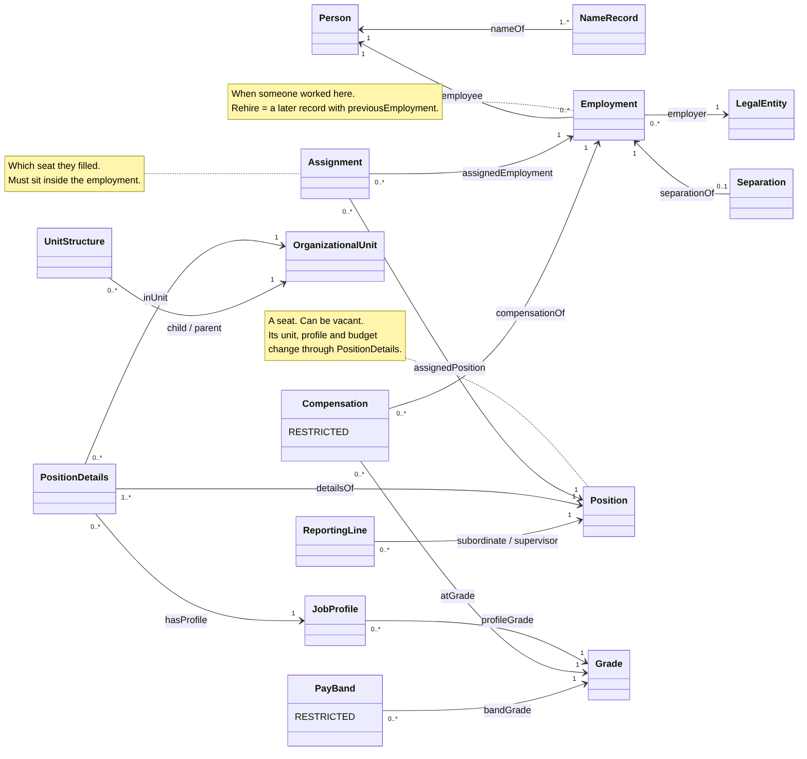
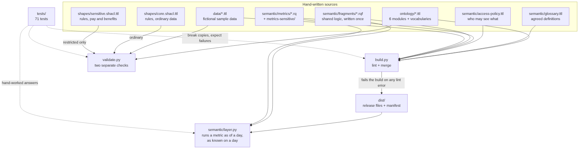

# HR Ontology

A modular, validated ontology for HR, with a semantic layer that defines business measures once. Everything in it is **fictional**: the company "Northwind Analytics", its people, and every number.

It is built to be a starting point for a real HR department. It covers the organisation and its seats, the employment lifecycle, hiring, skills and learning, and (kept apart) pay and benefits. It is not connected to any HR system.

## What is in it

| Part | What it gives you |
|---|---|
| **Ontology** (`ontology/`) | 35 classes, 101 properties, in six modules plus controlled vocabularies. Every term has a label, a definition, a sensitivity and an owner. |
| **Vocabularies** (`ontology/vocabularies.ttl`) | 64 coded values in 16 SKOS schemes (employment type, separation reason and its category, proficiency, and so on). Values can be added or retired without changing the ontology. |
| **Rules** (`shapes/`) | 109 SHACL rules for ordinary data and 21 for pay and benefits, each named (for example `EMPLOYMENT_OVERLAP`). The pay rules are a separate file. |
| **Semantic layer** (`semantic/`) | 14 measures (headcount, FTE, attrition, vacancy, time to fill, and so on) built from 7 shared fragments, plus a glossary and an access policy. |
| **Sample data** (`data/`) | 16 people with a leaver, a rehire, a name change, two people with the same name, a reorganisation, a vacancy, corrections and a promotion. |
| **Tooling** | `build.py` (lint and release), `validate.py` (rules), `semantic/layer.py` (measures). |
| **Tests** (`tests/`) | 71 tests. |



## Quick start

```bash
pip install -r requirements.txt     # rdflib and pyshacl
python3 build.py                    # lint the model and write dist/
python3 validate.py                 # run both rule sets on the sample data
python3 -m unittest discover -s tests -t .
python3 semantic/layer.py dist headcount asOf=2026-10-31
python3 semantic/layer.py dist attrition_rate periodStart=2024-01-01 periodEnd=2024-12-31
python3 semantic/layer.py dist fte asOf=2023-05-01 known=2023-05-01   # what we knew then
```

## The ideas that make it production-grade

**Identity is never a name.** A person is `P000007`. Names live in dated `NameRecord`s, so duplicate names (the sample has two "Daniel Kim"s) and name changes (Chloe Martin became Chloe Dubois) do not touch identity. A rule checks that every person IRI ends with the ID.

**Employment, assignment and position are three different things.** *Employment* is when someone worked for a legal entity. *Assignment* is which seat they filled, and must sit inside an employment. *Position* is the seat itself, which exists whether or not anyone is in it, so vacancies, headcount plans and reorganisations can be modelled. A leaver has only ended employments. A rehire has a later employment that points back with `previousEmployment`.

**Nothing is overwritten, and corrections are visible.** Every fact that changes over time is a `TemporalRecord` with *valid from / to* (when it was true) and *recorded on* (when the organisation learned it). A correction is a new record that `supersedes` the old one. That is what lets you ask "what did we report in March?": run a measure with `known=` set to that day.

**One definition per business term.** "Current employee" is written once, in `semantic/fragments/ActiveEmployment.rqf`. Nine measures reuse it, and a test fails if a measure copies the logic. Each measure names a glossary term, and the build fails if the term has no definition or owner.

**Pay is kept apart.** Compensation lives in its own ontology module, its own sample-data file, its own rule file and its own measures. The ordinary rules never mention pay, and tests check that the ordinary check never loads pay data. Pay records refer to employments by IRI only and hold no names. (The compensation *schema* is part of the ontology release; only the pay *data* is kept apart.)

**Quality is enforced, not hoped for.** `build.py` refuses to produce a release if any term lacks a definition, steward or sensitivity, if personal-data classes lack a retention period, if the data uses an undeclared term, if a glossary entry points to a missing file, or if the access policy leaves a level uncovered. Each lint rule has a test that breaks a copy of the project and checks the rule fires.

## Using the measures

A measure is a SPARQL file. Parameters are `asOf` (the day asked about), `known` (what had been recorded by then; default is everything), `periodStart` and `periodEnd`, and `withinDays`.

| Measure | Question it answers |
|---|---|
| `headcount`, `headcount_by_unit` | How many people, overall and per unit including sub-units, using the structure valid on the day |
| `fte` | Total full-time equivalents |
| `leavers`, `attrition_rate`, `attrition_by_category` | Who left and why, and the rate (leavers over the average of opening and closing headcount), split voluntary / involuntary / other |
| `rehires` | Who came back, and when they left and returned |
| `tenure` | Completed years in the current employment (restarts on rehire) |
| `span_of_control` | Direct reports on solid lines. Dotted lines are excluded and a vacant seat has no manager |
| `vacancy` | Positions not filled to their budgeted FTE |
| `time_to_fill` | Days from requisition opened to the hire's first day |
| `expiring_credentials` | Credentials ending soon that have not been renewed |
| `pay_outside_band`, `average_pay_by_unit` | **Restricted.** Pay against bands, and averages per unit and currency (never mixing currencies) |

Every measure returns person IDs next to any names, because names can repeat.

## Folder map

```
ontology/      core, organisation, employment, talent, hiring, compensation (restricted), vocabularies
shapes/        core.shacl.ttl (ordinary rules), sensitive.shacl.ttl (pay and benefits rules)
semantic/      glossary.ttl, access-policy.ttl, layer.py, fragments/, metrics/, metrics-sensitive/
data/          reference.ttl, people.ttl, compensation-data.ttl   (all fictional)
tests/         validation, metrics, build and lint tests
docs/          modelling decisions, governance, standards mapping, diagrams
dist/          the release (generated by build.py, do not edit)
VERSION        the one version number every module must carry
```



## More

- [docs/modeling-decisions.md](docs/modeling-decisions.md): why it is shaped this way, and what was rejected
- [docs/governance.md](docs/governance.md): ownership, change process, versioning, privacy and retention
- [docs/standards-mapping.md](docs/standards-mapping.md): how terms line up with W3C Org, schema.org, FOAF, SKOS, ESCO and O*NET
- [CHANGELOG.md](CHANGELOG.md)

## Limits and deferred work

This is an ontology and semantic layer, not a product. These are deliberately **not** built and are listed so nobody assumes otherwise:

- **No source integration.** The sample data is hand-written. The mapping layer that would load a real HR system, with reject reporting for bad rows, is a design task, not code.
- **No enforcement of access or retention.** The access policy and retention periods are data a serving system would use. Nothing here deletes or hides anything.
- **No time tracking, leave accrual, public holidays, compliance cases (visas, disciplinary, health and safety), goals, interview feedback or diversity data.** Each needs its own module and, for the last three, its own privacy design.
- **No dashboards or natural-language querying.** The measures are the layer such tools would sit on.
- **Standards are mapped, not imported.** ESCO or O*NET skill identifiers are not filled in; the taxonomy shows where `skos:closeMatch` links go. See the standards mapping.
- **Cycle rules look at most four levels deep.** SPARQL cannot follow time-bounded links recursively inside SHACL, so a reporting or unit loop longer than four is not caught. Real structures are rarely that deep.
- **The warning for pay outside a band is advisory.** It does not fail validation, because an exception can be intended.
- **Roll-ups go three levels below the top.** `headcount_by_unit` follows the unit structure up to three levels.
- **One calendar.** Dates are plain days. Time zones, public holidays and working-day counts are not modelled.
